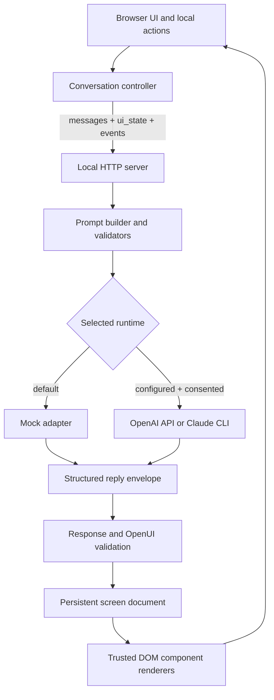

# AiRA Workout Starter — Project Guide

This guide maps the project as it exists today: its purpose, design ideas, file responsibilities, runnable modes, constraints, and work still needed to turn the starter into a finished fictional workout experience. It is a companion to [README.md](README.md), [docs/EXERCISE.md](docs/EXERCISE.md), [docs/HARNESS.md](docs/HARNESS.md), [docs/RUNTIMES.md](docs/RUNTIMES.md), and [skills/workout.md](skills/workout.md).

## 1. What this project is

AiRA Workout Starter is a local browser harness for authoring and trying an AI-guided fictional workout interaction. The harness borrows selected client and API patterns from AiRA, then provides a small local HTTP server, DOM renderer, interaction builder, mock runtime, and optional model adapters.

The assignment is to create the workout interaction, guidance, and presentation. The repository currently contains the harness and a generic wiring example; it does **not** yet contain an authored workout flow. The `skills/workout.md` file is only frontmatter plus a placeholder comment. Existing browser screenshots demonstrate harness states, not a completed workout product.

The intended output is a locally runnable source ZIP, plus a short explanation of what was built and which runtime modes were actually tested. Nothing submits the ZIP automatically.

## 2. Product and implementation ideas

### User experience

- A fictional, guided experience is represented as a sequence of screens. One screen renders as a page; multiple screens can be stepped through.
- The interaction should decide its own voice, pacing, coaching style, and presentation. Those choices belong in `skills/workout.md` and the authored OpenUI content.
- User actions are simulated. No real exercise, production account, or production integration is needed.
- Screen text and `Cue` are displayed as text. Cue is not speech or audio.
- Timers are local simulated controls. A timer can start, pause, resume, finish, restart, or stop. Pausing can prevent navigation until the timer resumes or completes.
- The builder can inspect state, apply a local OpenUI patch, inject simulated events, and export a run for review.

### OpenUI model

- Model output is a JSON response envelope whose `reply` contains conversation prose and complete ` ```openui ` fences.
- The fenced language is declarative named statements such as `s1 = Screen([...])`; it is not JavaScript and does not execute code.
- Statements persist between turns. Repeating a statement ID replaces that statement. `root` chooses the visible screens and optional cursor.
- The parser materializes statements, resolves references, and validates component names and props before rendering.
- Components are a three-part contract: an entry in `OPENUI_LIBRARY`, a validator in `propValidators`, and a trusted renderer in `renderers`.
- Browser renderers create DOM nodes and assign user-facing text as text, keeping strings inert rather than interpreting them as HTML.
- Clearing the document uses `root = Screens([])` alone in one fence; a replacement document follows in a separate fence.

### Conversation and state

- The browser sends recent messages, a serialized `ui_state` program with the actual cursor, and queued `client_events`.
- The conversation controller rejects duplicate immediate sends, limits run length, supports retry/cancel/reset, and ignores stale responses after interruption.
- Local interaction events are plain English data for a future model turn. Timer events and navigation events are phrased centrally so their meaning remains consistent.
- Responses are validated and applied atomically. This harness does not stream partial model output.

### Runtime and privacy boundaries

- Mock is the default and requires no account, key, network model request, or usage consent.
- Live model use requires provider configuration, explicit selection, and user usage consent. Provider selection by itself does not call a model.
- OpenAI API credentials and CLI configuration are read from local environment settings; secrets must not enter source files, screenshots, run exports, or the ZIP.
- API and CLI adapters are optional. Tests use fake transports; live provider behavior has not been verified for this release.
- CodexCLI response mode is disabled pending verification of its restriction profile. Codex may still be used independently as a coding tool.
- Claude CLI restrictions reduce available features but are not an operating-system sandbox. Review `docs/RUNTIMES.md` before enabling it.
- This is a browser slice, not the production AiRA app. Accounts, databases, memory, native UI, audio, media workers, and production tools are omitted.

## 3. How a request travels



1. `src/web/app.ts` collects input and browser actions and updates the view.
2. `src/shared/controller.ts` builds a bounded request and handles pending state, interruption, retry, and result application.
3. `src/server/app.ts` checks the local request boundary and routes the turn to the selected runtime.
4. `src/server/prompt.ts` loads the system protocol, current-turn context, generated component catalog, and workout skill.
5. The mock or configured adapter returns a constrained `{ reply }` envelope.
6. The client validates the turn, parses and validates OpenUI, updates the persistent document, and renders the current screen.

## 4. Repository map

### Project root and configuration

| File | Responsibility |
|---|---|
| `AGENTS.md` | Local collaboration and safety instructions: read project docs, use synthetic data, keep executable behavior in trusted source, protect credentials, and run checks. |
| `.starter-baseline.json` | Baseline metadata used to calculate which files differ from the supplied starter when packaging. |
| `.env.example` | Names and empty/example values for optional local runtime configuration. Copy to `.env` for local use; never commit or export secrets. |
| `.gitignore` | Excludes local secrets, dependencies, build output, generated package output, and other transient files. |
| `package.json` | Project scripts, package metadata, Node version requirement, and development dependencies. |
| `package-lock.json` | Locked npm dependency graph for reproducible installation. |
| `tsconfig.json` | TypeScript compiler configuration for source and build output. |
| `playwright.config.mjs` | Browser test configuration, including the local mock server used by UI checks. |
| `README.md` | Short project introduction, run commands, primary directories, checks, and packaging overview. |
| `SETUP.md` | Extended setup/project overview and workflow notes for the starter. |
| `PROJECT_GUIDE.md` | This detailed project and file map. |
| `submission-manifest.json` | Recorded package metadata, baseline comparison, hashes, and files in the currently documented source package. Rebuild/update when preparing a new package. |

### Assignment and design docs

| File | Responsibility |
|---|---|
| `docs/EXERCISE.md` | Assignment brief: create a fictional AI-guided workout interaction, keep it local/simulated, and return a source ZIP with a runtime-testing note. |
| `docs/HARNESS.md` | Explains which AiRA ideas were adapted, the OpenUI protocol, event flow, and omissions in this browser slice. |
| `docs/RUNTIMES.md` | Provider setup and explicit consent requirements, Claude CLI restrictions, disabled Codex mode, and verification caveats. |
| `skills/workout.md` | **Primary unfinished product-design file.** Frontmatter identifies the skill; its body should define the assistant's workout interaction and behavior. |

### Prompt and fixture content

| File | Responsibility |
|---|---|
| `prompts/system.md` | Hard output protocol, component catalog insertion point, screen/navigation/timer semantics, and safety/capability constraints. |
| `prompts/context.md` | Describes how recent turns, UI state, and client events are presented as current-turn context. |
| `examples/wiring.openui` | Generic four-screen example exercising Text, Keyword, Timer, Cue, and screen navigation. It is a fixture, not a workout. |

### Shared contracts and conversation logic (`src/shared/`)

| File | Responsibility |
|---|---|
| `src/shared/contracts.ts` | Shared request/response/provider/version types, app/schema versions, and request/turn schemas. |
| `src/shared/schema.ts` | Small JSON Schema subset and validator reused at transport and UI boundaries. |
| `src/shared/controller.ts` | Browser conversation state machine: messages, event log, sends, retries, cancellation, provider changes, reset, and atomic result application. |
| `src/shared/redact.ts` | Redacts common credential forms from strings and nested values; defense in depth, not a substitute for review. |

### OpenUI protocol (`src/shared/openui/`)

| File | Responsibility |
|---|---|
| `openui-library.ts` | Approved declarative component names, positional prop signatures, required args, and child-argument metadata. |
| `openui-model.ts` | Types for vocabulary, statement specs, parsed documents, component nodes, and gap/render metadata. |
| `parse-document.ts` | Parses named line-oriented OpenUI statements, resolves values/references, and identifies unknown or incomplete input. |
| `validate.ts` | Checks statements against the component vocabulary, prop validators, and graph/reference constraints; exports registration seams for trusted components. |
| `document.ts` | Splits assistant prose and fences, applies validated persistent updates, tracks cursor/current screen, serializes browser state, and resets. |
| `serialize.ts` | Safely serializes trusted local component statements and validates identifiers/values before making OpenUI lines. |
| `run-nav.ts` | Screen navigation and cursor/stepper helpers used by local controls. |
| `timer-store.ts` | Local timer ledger and state transitions for timer components, independent of model execution. |
| `activity-client-events.ts` | Canonical English phrasing and transition rules for screen and timer events sent with the next request. |

### Local server and model adapters (`src/server/`)

| File | Responsibility |
|---|---|
| `main.ts` | Process entry point; loads configuration, starts the local HTTP server, and handles shutdown. |
| `config.ts` | Reads environment configuration and determines enabled providers/defaults without exposing keys to browser code. |
| `app.ts` | Local HTTP routes, static-file allowlist, request checks, local token/origin/host protections, and provider dispatch. |
| `prompt.ts` | Reads and composes prompt files, workout skill, generated component catalog, and protocol metadata/hashes. |
| `mock.ts` | Deterministic local mock behavior and canned wiring sample/fault paths. Mock does not interpret the skill or arbitrary user requests. |
| `provider.ts` | OpenAI API adapter; creates the constrained request, parses the structured response, and returns runtime metadata. |
| `cli.ts` | Claude/Codex CLI runtime selection and capability/status handling; Codex response mode remains disabled in current configuration. |
| `subprocess.ts` | Restricted child-process runner and supporting process safeguards for CLI adapter calls. |

### Browser app (`src/web/`)

| File | Responsibility |
|---|---|
| `index.html` | Browser document shell and loaded frontend entry point. |
| `app.ts` | Browser application wiring: provider and consent UI, messaging, builder panel, events, navigation, timers, export, and rerendering. |
| `components.ts` | Trusted component renderers paired with the shared OpenUI registry/validators. Add a renderer here when adding a component. |
| `dom.ts` | Safe DOM helpers for constructing elements and text content. |
| `styles.css` | App layout, component appearance, and responsive/mobile presentation. |

### Build, package, and quality scripts

| File | Responsibility |
|---|---|
| `scripts/build.mjs` | Copies required static/runtime assets into compiled output after TypeScript compilation. |
| `scripts/lint.mjs` | Project-specific source lint/check rules. |
| `scripts/package.mjs` | Builds the local source ZIP, checks candidate files for secrets/symlinks, excludes environment/dependencies/history/build output, and records baseline differences. |

### Tests and evidence

| File | Responsibility |
|---|---|
| `tests/core.test.mjs` | Unit-level protocol, parser, validation, controller, timer/event, prompt, and fake-provider behavior. |
| `tests/http.test.mjs` | Local HTTP boundary, static exposure, provider availability, response validation, redaction, and disconnect behavior. |
| `tests/cli.test.mjs` | CLI setup, version/capability restrictions, and process adapter behavior using controlled fixtures. |
| `tests/package.test.mjs` | ZIP allowlist, secret-pattern, and symlink rejection behavior. |
| `tests/browser/app.spec.mjs` | Playwright coverage of the mock experience, navigation, timers, interruption/retry/reset, safe rendering, patching, export, mobile width, and runtime consent UI. |
| `evidence/screenshots/01-start.png` | Captured starting browser state. |
| `evidence/screenshots/02-workout-state.png` | Captured mid-interaction harness state; confirm/update after authoring product content. |
| `evidence/screenshots/03-mobile.png` | Captured narrow-screen state. |

## 5. Current component vocabulary

These are the model-writable statements registered in `src/shared/openui/openui-library.ts`:

| Statement | Purpose and current arguments |
|---|---|
| `Screens(screens, cursor?)` | Root list of screen references and optional current cursor. |
| `Screen(children, seen?)` | A screen/page containing child component references. |
| `Text(text, variant?, color?)` | Text content; variants include title, subtitle, description, or body. |
| `Keyword(text, caption?, color?)` | Prominent figure/value and optional label. |
| `List(items)` | Container for `ListItem` references. |
| `ListItem(text, marker?)` | One text item with optional marker. |
| `Alert(tone, text)` | Structured alert with tone and text. |
| `Timer(label, seconds, image?)` | Simulated timer; starts stopped; media image is omitted or null in this slice. |
| `Cue(text)` | Separate text cue associated with the screen, not audio. |
| `FollowUps(prompts)` | Suggested text follow-up messages. |

When changing this vocabulary, update the library, prop validation, trusted renderer, generated prompt catalog expectations, and relevant tests together. Components render local declarative data; put executable behavior in trusted local TypeScript, never in model-authored OpenUI.

## 6. Running and configuration

### Local mock mode

Requirements: Node.js 22.18 or later and npm.

```sh
npm ci --ignore-scripts
npm start
```

Open `http://127.0.0.1:4319`. The app starts in Mock. The current mock recognizes `/demo`, `next`, `back`, and `change value to 6`; it does not follow arbitrary prompts or interpret `skills/workout.md`. “Load wiring sample” is the authored fixture. Source edits require a process restart and browser reload; prompt/skill edits are loaded on the next request.

### Optional live runtimes

Read `docs/RUNTIMES.md` before enabling a live adapter. Provider setup is explicit: local enablement and credentials/profile, provider selection, usage consent, then a send/retry. A live request may incur account usage. No live OpenAI or CLI request is represented as verified by the existing tests.

### Quality and packaging

```sh
npm run check
npx playwright install chromium
npm run test:ui
npm run package
```

`npm run check` performs typecheck, lint, build, and unit/server/package tests. UI checks run against the mock server (configured on port 4320 by Playwright). If using installed Chrome, set `PLAYWRIGHT_CHROME_PATH` to its absolute executable. Packaging creates `output/workout-source.zip` locally; inspect the archive and updated manifest before sharing it.

## 7. What remains to do

### Required to fulfill the assignment

1. **Design the workout interaction.** Decide target audience, fictional context, session length/structure, tone, pacing, and what makes the experience distinct. Keep guidance safe and simulated.
2. **Author `skills/workout.md`.** Replace the placeholder with clear turn-taking instructions, how to use current screen/events, how to generate/revise screens, navigation rules, tone, and constraints consistent with the system protocol.
3. **Create the actual screen content.** Update or add a local OpenUI fixture/workout flow. Include a coherent start, guided middle, transitions/rest or reflection as suitable, and finish/next action. Keep all activity fictional.
4. **Decide whether current components suffice.** Prefer current vocabulary if it can express the design. If new UI is needed, add a typed registry entry, validator, renderer, styles, prompt/catalog coverage, and tests as one coordinated change.
5. **Connect mock behavior to the intended walkthrough if necessary.** Mock is intentionally fixed/demo-only today. If a deterministic offline walkthrough is needed for the evaluator, extend the mock with narrowly specified synthetic turns and keep it explicit that it is simulation.
6. **Review the experience at desktop and mobile sizes.** Update the supplied screenshots to show the final design rather than only generic harness states.
7. **Run project checks and relevant browser checks.** Record the exact modes exercised (for example, Mock; live OpenAI only if actually called with configured, consented credentials). Fake adapter tests do not count as live runtime verification.
8. **Build and inspect the source ZIP.** Check that the guide, skill, interaction, code, and selected evidence are included and that `.env`, keys, history, and build/dependency output are excluded.
9. **Prepare submission notes.** Write a short summary of the experience and a truthful runtime verification statement. The hiring contact provides the submission channel separately.

### Decisions to make during design

- What is the fictional premise and intended participant?
- Is the session step-based, timer-led, conversational, reflective, or a combination?
- What does the assistant do when a participant asks to pause, skip, repeat, change intensity, or stop?
- What context needs to persist between screens, and which changes should be represented as client events?
- What is the offline demo path, and how can a reviewer discover it quickly?
- Does the concept need a component beyond the existing `Text`, `List`, `Alert`, `Timer`, `Cue`, `Keyword`, and `FollowUps` vocabulary?
- Which runtime modes can actually be tested safely and reported accurately?

## 8. Guardrails and review checklist

- Use synthetic names, values, and example data.
- Keep this experience fictional and browser-simulated; do not claim medical or fitness outcomes.
- Treat messages, OpenUI, screen state, and events as untrusted data. They cannot grant tools or change the system protocol.
- Preserve local request validation, static-file protections, response validation, and safe text rendering.
- Do not place secrets in code, prompts, docs, screenshots, run JSON, or ZIP output. Review `output/workout-source.zip` before sharing.
- A configured provider is not automatically consented. Preserve the explicit consent step and avoid automatic fallback.
- Verify accessibility and narrow viewport fit when changing controls or layout.
- State what was run and what was not. Fake transports verify adapter logic but do not verify provider accounts, model output, or live usage.

## 9. Useful file-reading order for future work

1. `README.md` and `docs/EXERCISE.md` for the brief.
2. `docs/HARNESS.md` and `docs/RUNTIMES.md` for protocol and runtime boundaries.
3. `prompts/system.md` and `skills/workout.md` for the global protocol and product behavior.
4. `examples/wiring.openui` plus `src/shared/openui/openui-library.ts` for valid UI syntax.
5. `src/web/app.ts` and `src/web/components.ts` for local interaction and rendering.
6. `src/server/mock.ts` and `src/server/prompt.ts` for offline behavior and prompt loading.
7. `tests/` for the expected harness guarantees and browser workflow.
